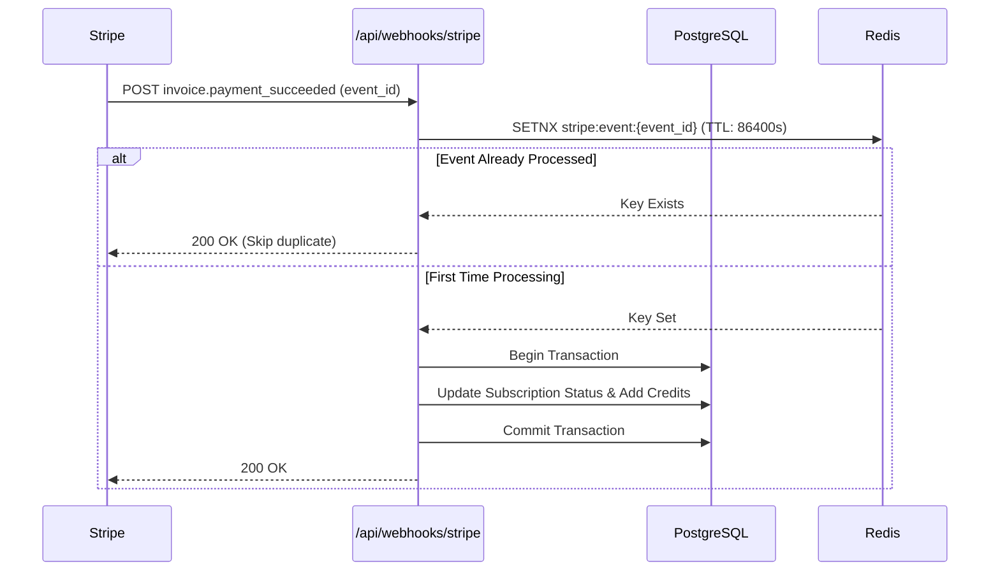

# Fullstack SaaS Architecture & Media Pipeline Playbook

## 1. High-Level Architectural Flow for UGC SaaS
UGC platforms are media-heavy and computationally expensive. Decoupling the ingestion, generation, and delivery layers is vital to preventing server crashes and ballooning cloud bills:

```
[Browser / Client]
       │
       ├─ (1) Requests pre-signed upload URL ──► [Fast API Server]
       ├─ (2) Uploads raw video/assets ────────► [Cloudflare R2 / AWS S3]
       │                                                 │
       │                                          (3) S3 Webhook Event
       ▼                                                 ▼
[Dashboard SSE / WS] ◄─── (6) Job Complete ─── [BullMQ / Worker Queue]
                                                         │
                                                  (4) Video Transcode /
                                                      FFmpeg / AI Process
                                                         │
                                                  (5) Save Optimized Media
                                                         ▼
                                                [CDN / R2 Public Bucket]
```

---

## 2. Direct-to-Storage Ingestion Pattern
**Never route user video files through application server memory.**

### Implementation Steps:
1. Client sends request to `/api/media/upload-url` with `{ fileName, fileType, fileSize }`.
2. Server validates user auth, quota limits, and allowed MIME types (`video/mp4`, `video/webm`, `image/png`, `image/jpeg`).
3. Server generates pre-signed PUT URL with a 15-minute expiration window:
   ```typescript
   import { PutObjectCommand, S3Client } from "@aws-sdk/client-s3";
   import { getSignedUrl } from "@aws-sdk/s3-request-presigner";

   export async function generateUploadUrl(key: string, contentType: string) {
     const command = new PutObjectCommand({
       Bucket: process.env.STORAGE_BUCKET_NAME,
       Key: key,
       ContentType: contentType,
     });
     return await getSignedUrl(s3Client, command, { expiresIn: 900 });
   }
   ```
4. Client executes direct `PUT` request with upload progress bar.

---

## 3. Resilient Background Job Queue Pattern (BullMQ / Redis)
- **Queue Separation**: Maintain separate queues based on priority and resource intensity:
  - `critical-queue`: Transcode and export operations for paying users.
  - `standard-queue`: Free tier exports, thumbnail generation, webhook delivery.
  - `notification-queue`: Transactional emails, push notifications.
- **Worker Concurrency & Resource Limits**:
  - Bound concurrent video/AI processing jobs per worker node to avoid Out-Of-Memory (OOM) kills.
  - Set timeouts per job (e.g., maximum 5 minutes for video compilation).

---

## 4. Stripe Subscription & Webhook Idempotency Matrix
Payment failures and double-charges destroy SaaS reputation. Implement ironclad webhook handlers:



### Critical Webhook Events to Handle:
- `customer.subscription.created` & `customer.subscription.updated`: Update plan tiers, credit quotas, and current period end dates.
- `customer.subscription.deleted`: Instantly downgrade account to free tier without deleting customer data.
- `invoice.payment_failed`: Trigger automated grace-period notification emails and show in-app payment update modal.
