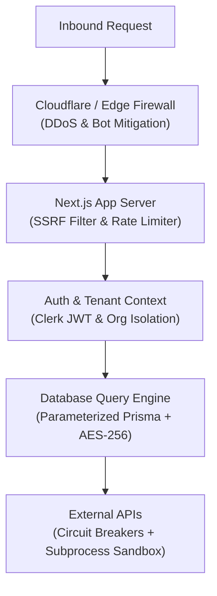

# AutoUGC — Security Policy & Controls

Security is fundamental to the AutoUGC platform. This document outlines the security controls, cryptographic primitives, threat mitigation defenses, and vulnerability disclosure protocol enforced across the software.

---

## 1. Security Architecture & Threat Model

AutoUGC operates on a **defense-in-depth** model across the network, application, and database tiers:

---

## 2. Cryptographic Security Controls

### 2.1 Social Media OAuth Token Encryption (AES-256-GCM)
- **Algorithm:** Authenticated Encryption with Associated Data (AEAD) using `aes-256-gcm`.
- **Key Management:** Encrypted with 256-bit key from `ENCRYPTION_KEY` environment variable.
- **Initialization Vector (IV):** Unique 12-byte cryptographically random IV per encryption operation.
- **Tamper Protection:** 16-byte authentication tag verified prior to decryption. Any payload tampering immediately throws an authentication error (`Unsupported state or unable to authenticate data`).
- **Implementation:** [`src/lib/security/crypto.ts`](file:///c:/Users/Hello/Desktop/projects/UGC_project/src/lib/security/crypto.ts).

### 2.2 1-Hour Pre-Publish Approval Signatures (HMAC-SHA256)
- **Algorithm:** HMAC with SHA-256 (`crypto.createHmac('sha256', secret)`).
- **Expiration:** Hardcoded 3600-second (1 hour) cryptographic TTL.
- **Single-Use Replay Attack Defense:** Once consumed, the token's hash is marked `consumed: true` in Neon PostgreSQL. Subsequent attempts are rejected with HTTP 401.
- **Implementation:** [`src/lib/campaigns/approvalTokens.ts`](file:///c:/Users/Hello/Desktop/projects/UGC_project/src/lib/campaigns/approvalTokens.ts).

---

## 3. Network & Application Layer Defenses

### 3.1 Server-Side Request Forgery (SSRF) Mitigation
All user-supplied target URLs submitted to the web scraper are sanitized before network resolution:
- **Blocked Targets:**
  - Loopback addresses (`127.0.0.1`, `localhost`, `::1`).
  - RFC 1918 Private Subnets (`10.0.0.0/8`, `172.16.0.0/12`, `192.168.0.0/16`).
  - Cloud Metadata Endpoints (`169.254.169.254`, `metadata.google.internal`).
  - Non-HTTP protocols (`file://`, `ftp://`, `gopher://`, `dict://`).
- **Implementation:** [`src/lib/scraper/productScraper.ts`](file:///c:/Users/Hello/Desktop/projects/UGC_project/src/lib/scraper/productScraper.ts).

### 3.2 Sliding-Window Rate Limiting
- **Engine:** In-memory sliding-window log with automatic cleanup.
- **Tiers:**
  - Authentication / Webhook endpoints: 30 requests/minute.
  - Video rendering / AI generation: 10 requests/minute.
  - Standard API endpoints: 60 requests/minute.
- **Headers:** Conforms to RFC 6585 with `X-RateLimit-Limit`, `X-RateLimit-Remaining`, and `Retry-After`.
- **Implementation:** [`src/lib/security/rateLimiter.ts`](file:///c:/Users/Hello/Desktop/projects/UGC_project/src/lib/security/rateLimiter.ts).

### 3.3 Cross-Site Request Forgery (CSRF) Prevention
- State-changing HTTP methods (`POST`, `PUT`, `DELETE`, `PATCH`) validate the inbound `Origin` and `Referer` headers against `NEXT_PUBLIC_APP_URL`.
- Cross-origin form submissions and unauthorized cross-site fetch calls are rejected with HTTP 403.

### 3.4 SQL Injection Defense
- 100% of database interactions are orchestrated via Prisma ORM parameterized queries.
- Raw string concatenations inside database queries are strictly prohibited.
- Verified in `tests/securityAudit.test.ts`.

---

## 4. Multi-Tenant Data Isolation

- Every database query strictly filters by `organizationId`.
- Clerk session claims (`userId`, `orgId`) are resolved on every request via `src/lib/auth/authContext.ts`.
- Tenant A can never query, mutate, delete, or list assets (projects, videos, social accounts, credentials) belonging to Tenant B.
- Verified by automated multi-tenant isolation tests in `tests/dashboardTenancyIsolation.test.ts`.

---

## 5. Vulnerability Disclosure & Bug Reporting

We take security vulnerabilities seriously. If you discover a vulnerability in AutoUGC:

1. **Do NOT open a public GitHub issue.**
2. Email your detailed findings to: **security@autougc.com**.
3. Include:
   - Vulnerability description and attack vector.
   - Step-by-step reproduction guide or proof-of-concept.
   - Potential impact assessment.
4. **SLA:** Our security team acknowledges reports within **24 hours** and provides triage updates every **48 hours** until resolution.
