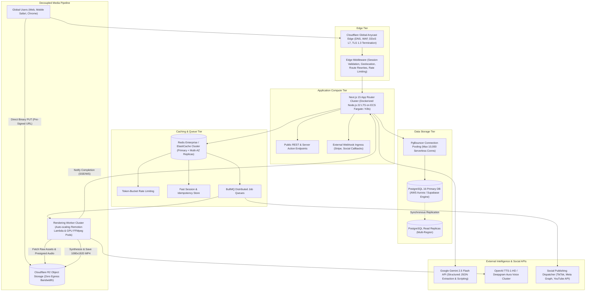
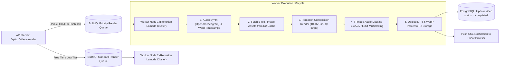

# Systems Architecture & Detailed Design Specification
## Project: AutoUGC — Autonomous AI Video Ads & Social Distribution Engine
**Document Version:** 1.0.0  
**Target Scale:** 10,000,000+ Registered Users | 500,000+ Daily Video Renders  
**Owner:** Technical Co-Founder & Principal Systems Architect  

---

## 1. High-Level System Architecture

### 1.1 Global Infrastructure Topology



### 1.2 Core Architectural Invariants
1. **Stateless Compute**: Zero user state or uploaded binary buffers reside on the Next.js application servers. An app pod can terminate at any millisecond with zero data loss.
2. **Zero-Memory File Streaming**: Web servers NEVER proxy video, audio, or image binaries. All uploads execute directly from the browser to Cloudflare R2 via cryptographically signed pre-signed PUT URLs.
3. **Database Transaction Bounding**: Third-party API calls (Gemini, Stripe, TTS, S3) are strictly prohibited inside open PostgreSQL transaction blocks. Transactions must execute in $\le 5$ milliseconds.
4. **Idempotency Everywhere**: Every billing mutation, credit consumption, and video render request requires an immutable `Idempotency-Key` stored in Redis with an atomic TTL.

---

## 2. Complete Database Schema (PostgreSQL 16)

The database schema utilizes UUIDv7 for time-ordered primary keys, strict foreign key constraints, composite performance indexes, and JSONB schemas for dynamic creative configurations.

```sql
-- Extensions
CREATE EXTENSION IF NOT EXISTS "uuid-ossp";
CREATE EXTENSION IF NOT EXISTS "pgcrypto";

-- ============================================================================
-- 1. TENANCY & USERS
-- ============================================================================

CREATE TABLE organizations (
    id UUID PRIMARY KEY DEFAULT gen_random_uuid(),
    name VARCHAR(255) NOT NULL,
    slug VARCHAR(100) UNIQUE NOT NULL,
    billing_email VARCHAR(255) NOT NULL,
    created_at TIMESTAMPTZ NOT NULL DEFAULT NOW(),
    updated_at TIMESTAMPTZ NOT NULL DEFAULT NOW()
);
CREATE INDEX idx_organizations_slug ON organizations(slug);

CREATE TABLE users (
    id UUID PRIMARY KEY DEFAULT gen_random_uuid(),
    email VARCHAR(255) UNIQUE NOT NULL,
    full_name VARCHAR(255),
    avatar_url TEXT,
    password_hash VARCHAR(255), -- NULL for OAuth/Magic-link users
    email_verified_at TIMESTAMPTZ,
    created_at TIMESTAMPTZ NOT NULL DEFAULT NOW(),
    updated_at TIMESTAMPTZ NOT NULL DEFAULT NOW()
);
CREATE INDEX idx_users_email ON users(email);

CREATE TABLE organization_members (
    id UUID PRIMARY KEY DEFAULT gen_random_uuid(),
    organization_id UUID NOT NULL REFERENCES organizations(id) ON DELETE CASCADE,
    user_id UUID NOT NULL REFERENCES users(id) ON DELETE CASCADE,
    role VARCHAR(50) NOT NULL CHECK (role IN ('owner', 'admin', 'editor', 'viewer')),
    created_at TIMESTAMPTZ NOT NULL DEFAULT NOW(),
    UNIQUE (organization_id, user_id)
);
CREATE INDEX idx_org_members_user ON organization_members(user_id);
CREATE INDEX idx_org_members_org ON organization_members(organization_id);

-- ============================================================================
-- 2. SUBSCRIPTIONS, QUOTAS & USAGE LEDGER
-- ============================================================================

CREATE TABLE subscriptions (
    id UUID PRIMARY KEY DEFAULT gen_random_uuid(),
    organization_id UUID UNIQUE NOT NULL REFERENCES organizations(id) ON DELETE CASCADE,
    stripe_customer_id VARCHAR(100) UNIQUE NOT NULL,
    stripe_subscription_id VARCHAR(100) UNIQUE,
    plan_tier VARCHAR(50) NOT NULL CHECK (plan_tier IN ('free', 'starter', 'growth', 'scale')),
    status VARCHAR(50) NOT NULL CHECK (status IN ('active', 'trialing', 'past_due', 'canceled', 'unpaid')),
    credits_monthly_allowance INT NOT NULL DEFAULT 3,
    credits_remaining INT NOT NULL DEFAULT 3,
    current_period_start TIMESTAMPTZ NOT NULL DEFAULT NOW(),
    current_period_end TIMESTAMPTZ NOT NULL,
    cancel_at_period_end BOOLEAN NOT NULL DEFAULT FALSE,
    created_at TIMESTAMPTZ NOT NULL DEFAULT NOW(),
    updated_at TIMESTAMPTZ NOT NULL DEFAULT NOW()
);
CREATE INDEX idx_subscriptions_org ON subscriptions(organization_id);
CREATE INDEX idx_subscriptions_stripe_sub ON subscriptions(stripe_subscription_id);

CREATE TABLE credit_transactions (
    id UUID PRIMARY KEY DEFAULT gen_random_uuid(),
    organization_id UUID NOT NULL REFERENCES organizations(id) ON DELETE CASCADE,
    user_id UUID REFERENCES users(id) ON DELETE SET NULL,
    amount INT NOT NULL, -- Negative for deduction, positive for purchase/refund
    balance_after INT NOT NULL,
    reason VARCHAR(100) NOT NULL, -- 'render_deduction', 'monthly_grant', 'purchase', 'render_failed_refund'
    reference_id UUID, -- Links to videos.id or payment_intent_id
    created_at TIMESTAMPTZ NOT NULL DEFAULT NOW()
);
CREATE INDEX idx_credit_tx_org_created ON credit_transactions(organization_id, created_at DESC);

-- ============================================================================
-- 3. PROJECTS & SCRAPED ASSETS
-- ============================================================================

CREATE TABLE projects (
    id UUID PRIMARY KEY DEFAULT gen_random_uuid(),
    organization_id UUID NOT NULL REFERENCES organizations(id) ON DELETE CASCADE,
    created_by_user_id UUID NOT NULL REFERENCES users(id),
    name VARCHAR(255) NOT NULL,
    target_url TEXT NOT NULL,
    brand_name VARCHAR(255) NOT NULL,
    brand_logo_url TEXT,
    primary_color VARCHAR(10) NOT NULL DEFAULT '#10B981',
    accent_color VARCHAR(10) NOT NULL DEFAULT '#F59E0B',
    summary TEXT,
    created_at TIMESTAMPTZ NOT NULL DEFAULT NOW(),
    updated_at TIMESTAMPTZ NOT NULL DEFAULT NOW()
);
CREATE INDEX idx_projects_org_created ON projects(organization_id, created_at DESC);

CREATE TABLE scraped_assets (
    id UUID PRIMARY KEY DEFAULT gen_random_uuid(),
    project_id UUID NOT NULL REFERENCES projects(id) ON DELETE CASCADE,
    asset_type VARCHAR(50) NOT NULL CHECK (asset_type IN ('image', 'logo', 'heading', 'benefit', 'review')),
    url TEXT,
    content_text TEXT,
    metadata JSONB DEFAULT '{}', -- { width: 800, height: 800, contrast_ratio: 4.5 }
    created_at TIMESTAMPTZ NOT NULL DEFAULT NOW()
);
CREATE INDEX idx_scraped_assets_project ON scraped_assets(project_id);

-- ============================================================================
-- 4. VIRAL SCRIPTS & VIDEO RENDER ENTITIES
-- ============================================================================

CREATE TABLE scripts (
    id UUID PRIMARY KEY DEFAULT gen_random_uuid(),
    project_id UUID NOT NULL REFERENCES projects(id) ON DELETE CASCADE,
    angle_type VARCHAR(50) NOT NULL CHECK (angle_type IN ('negative_hook', 'secret_hack', 'problem_agitation')),
    hook_text TEXT NOT NULL,
    body_text TEXT NOT NULL,
    cta_text TEXT NOT NULL,
    full_script_text TEXT NOT NULL,
    suggested_visual_cues JSONB NOT NULL DEFAULT '[]',
    caption_copy TEXT NOT NULL,
    hashtags TEXT[] NOT NULL DEFAULT '{}',
    created_at TIMESTAMPTZ NOT NULL DEFAULT NOW()
);
CREATE INDEX idx_scripts_project ON scripts(project_id);

CREATE TABLE videos (
    id UUID PRIMARY KEY DEFAULT gen_random_uuid(),
    project_id UUID NOT NULL REFERENCES projects(id) ON DELETE CASCADE,
    organization_id UUID NOT NULL REFERENCES organizations(id) ON DELETE CASCADE,
    script_id UUID NOT NULL REFERENCES scripts(id) ON DELETE CASCADE,
    voice_id VARCHAR(50) NOT NULL DEFAULT 'alex_casual_dtc',
    aspect_ratio VARCHAR(20) NOT NULL DEFAULT '9:16',
    duration_seconds NUMERIC(4, 2) NOT NULL DEFAULT 15.00,
    has_watermark BOOLEAN NOT NULL DEFAULT FALSE,
    audio_url TEXT,
    video_url TEXT, -- Final 1080x1920 MP4 stored in R2
    thumbnail_url TEXT,
    render_status VARCHAR(50) NOT NULL DEFAULT 'draft' CHECK (render_status IN ('draft', 'queued', 'rendering', 'completed', 'failed')),
    render_job_id VARCHAR(100), -- BullMQ or Remotion Lambda Render ID
    error_message TEXT,
    created_at TIMESTAMPTZ NOT NULL DEFAULT NOW(),
    updated_at TIMESTAMPTZ NOT NULL DEFAULT NOW()
);
CREATE INDEX idx_videos_org_status ON videos(organization_id, render_status);
CREATE INDEX idx_videos_created ON videos(created_at DESC);

-- ============================================================================
-- 5. SOCIAL ACCOUNTS & AUTOMATED SCHEDULING
-- ============================================================================

CREATE TABLE social_accounts (
    id UUID PRIMARY KEY DEFAULT gen_random_uuid(),
    organization_id UUID NOT NULL REFERENCES organizations(id) ON DELETE CASCADE,
    platform VARCHAR(50) NOT NULL CHECK (platform IN ('tiktok', 'instagram', 'youtube')),
    platform_user_id VARCHAR(255) NOT NULL,
    account_handle VARCHAR(255) NOT NULL,
    encrypted_access_token TEXT NOT NULL, -- AES-256-GCM encrypted
    encrypted_refresh_token TEXT,
    token_expires_at TIMESTAMPTZ,
    is_active BOOLEAN NOT NULL DEFAULT TRUE,
    created_at TIMESTAMPTZ NOT NULL DEFAULT NOW(),
    updated_at TIMESTAMPTZ NOT NULL DEFAULT NOW(),
    UNIQUE (organization_id, platform, platform_user_id)
);
CREATE INDEX idx_social_accounts_org ON social_accounts(organization_id);

CREATE TABLE scheduled_posts (
    id UUID PRIMARY KEY DEFAULT gen_random_uuid(),
    video_id UUID NOT NULL REFERENCES videos(id) ON DELETE CASCADE,
    organization_id UUID NOT NULL REFERENCES organizations(id) ON DELETE CASCADE,
    social_account_id UUID NOT NULL REFERENCES social_accounts(id) ON DELETE CASCADE,
    caption TEXT NOT NULL,
    scheduled_for TIMESTAMPTZ NOT NULL,
    publish_status VARCHAR(50) NOT NULL DEFAULT 'pending' CHECK (publish_status IN ('pending', 'processing', 'published', 'failed')),
    platform_post_id VARCHAR(255),
    error_log TEXT,
    retry_count INT NOT NULL DEFAULT 0,
    created_at TIMESTAMPTZ NOT NULL DEFAULT NOW(),
    updated_at TIMESTAMPTZ NOT NULL DEFAULT NOW()
);
CREATE INDEX idx_scheduled_posts_dispatch ON scheduled_posts(publish_status, scheduled_for) 
WHERE publish_status = 'pending';
```

---

## 3. REST API Specification & Contracts

All endpoints enforce request/response validation through Zod schemas. The standardized envelope is:
- **Success (200, 201)**: `{ "success": true, "data": T, "meta": { "timestamp": string, "requestId": string } }`
- **Error (4xx, 5xx)**: `{ "success": false, "error": { "code": string, "message": string, "details": any } }`

### Endpoint 1: Content Ingestion & Asset Scraping
- **Route**: `POST /api/v1/projects/scrape`
- **Rate Limit**: 10 req/min per IP | 60 req/min per Authenticated Org
- **Request Payload**:
```json
{
  "url": "https://getlumina.io/smart-desk-lamp",
  "organizationId": "d3b07384-d113-46fb-a029-4a92c10b77a1"
}
```
- **Response Payload (200 OK)**:
```json
{
  "success": true,
  "data": {
    "projectId": "8f3e2b9c-5e4a-4d22-92a1-cf819e917d42",
    "brandName": "Lumina",
    "pageTitle": "Smart Desk Lamp for Deep Focus & Productivity",
    "summary": "AI-powered adaptive lighting designed for developers and deep-work professionals.",
    "brandColors": {
      "primary": "#3B82F6",
      "accent": "#F59E0B"
    },
    "assets": [
      {
        "type": "logo",
        "url": "https://r2.autougc.com/projects/8f3e/logo_lumina.png",
        "aspectRatio": 2.5
      },
      {
        "type": "image",
        "url": "https://r2.autougc.com/projects/8f3e/lamp_hero_desk.jpg",
        "aspectRatio": 1.0
      }
    ]
  },
  "meta": {
    "timestamp": "2026-10-25T05:12:00.000Z",
    "requestId": "req_99a81b2c"
  }
}
```

### Endpoint 2: AI Viral Script & Creative Hook Generation
- **Route**: `POST /api/v1/scripts/generate`
- **Rate Limit**: 30 req/min per Authenticated Org
- **Request Payload**:
```json
{
  "projectId": "8f3e2b9c-5e4a-4d22-92a1-cf819e917d42",
  "targetAudience": "Software engineers and remote workers with eye strain"
}
```
- **Response Payload (200 OK)**:
```json
{
  "success": true,
  "data": {
    "scripts": [
      {
        "scriptId": "a1c9e8d3-44f2-48a1-b841-8f92110c9e01",
        "angleType": "negative_hook",
        "hook": "Stop coding under harsh fluorescent lights in 2026.",
        "body": "If you get headaches by 3 PM, your monitor setup is ruining your eyes. Lumina auto-matches natural daylight so your eyes feel rested even after 10-hour sprints.",
        "cta": "Click the link below and get $30 off your Lumina setup today.",
        "estimatedDurationSeconds": 14.5,
        "caption": "Why do engineers ignore lighting until they get migraines? 💡 Here’s the fix for deep work focus. #desksetup #softwareengineer #productivitytips #remotework #techgadgets"
      },
      {
        "scriptId": "b2d0f9e4-55a3-49b2-c952-9a03221d0f12",
        "angleType": "secret_hack",
        "hook": "The $80 desk upgrade that basically eliminated my 3 PM brain fog.",
        "body": "I thought I needed more coffee, but turns out my lighting was triggering eye strain. Lumina adapts color temperature in real time.",
        "cta": "Grab yours with free shipping before the current batch sells out.",
        "estimatedDurationSeconds": 13.8,
        "caption": "Brain fog fix for remote workers you didn't know you needed. 🚀 #wfh #deskaccessories #lumina #deepwork"
      }
    ]
  }
}
```

### Endpoint 3: Pre-Signed Media Upload URL Generation
- **Route**: `POST /api/v1/media/upload-url`
- **Rate Limit**: 120 req/min per Authenticated Org
- **Request Payload**:
```json
{
  "projectId": "8f3e2b9c-5e4a-4d22-92a1-cf819e917d42",
  "fileName": "custom_product_demo.mp4",
  "contentType": "video/mp4",
  "fileSizeBytes": 14500000
}
```
- **Response Payload (200 OK)**:
```json
{
  "success": true,
  "data": {
    "uploadUrl": "https://r2.autougc.com/raw/8f3e/custom_product_demo.mp4?X-Amz-Algorithm=AWS4-HMAC-SHA256&X-Amz-Expires=900...",
    "publicAssetUrl": "https://cdn.autougc.com/raw/8f3e/custom_product_demo.mp4",
    "expiresAt": "2026-10-25T05:27:00.000Z"
  }
}
```

### Endpoint 4: Video Synthesis & Render Trigger
- **Route**: `POST /api/v1/videos/render`
- **Headers**: `Idempotency-Key: idemp_83b271fca`
- **Request Payload**:
```json
{
  "scriptId": "a1c9e8d3-44f2-48a1-b841-8f92110c9e01",
  "voiceId": "alex_casual_dtc",
  "subtitleStyle": {
    "fontFamily": "Plus Jakarta Sans",
    "fontSize": 48,
    "primaryColor": "#FFFFFF",
    "highlightColor": "#F59E0B",
    "textStroke": "3px #000000"
  },
  "backgroundMusic": "lofi_focus_groove_120bpm"
}
```
- **Response Payload (202 Accepted)**:
```json
{
  "success": true,
  "data": {
    "videoId": "c3e1a0f5-66b4-4ac3-da63-ab14332e1a23",
    "status": "queued",
    "estimatedTimeSeconds": 14,
    "creditCost": 1,
    "remainingCredits": 24
  }
}
```

---

## 4. Asynchronous Media Pipeline & Remotion Architecture

### 4.1 Distributed Worker Queue Topology



### 4.2 Kinetic Subtitle Synchronization Spec
1. **Audio Word Alignment**: The TTS engine returns word boundaries:
   ```json
   [
     { "word": "Stop", "start": 0.00, "end": 0.28 },
     { "word": "coding", "start": 0.30, "end": 0.65 },
     { "word": "under", "start": 0.68, "end": 0.92 },
     { "word": "harsh", "start": 0.95, "end": 1.25 },
     { "word": "fluorescent", "start": 1.28, "end": 1.82 },
     { "word": "lights", "start": 1.85, "end": 2.20 }
   ]
   ```
2. **Remotion Composition Frame Mapping**:
   At 30 FPS, frame index $F = \lfloor t \times 30 \rfloor$.
   The current word in frame $F$ is highlighted with the `highlightColor` (`#F59E0B`) with a scale spring `transform: scale(1.08)`.
3. **Safe Zones for TikTok & Reels**:
   - Subtitles are locked between $Y = 1200\text{px}$ and $Y = 1450\text{px}$ on a $1080\times 1920$ canvas. This ensures zero obstruction from TikTok’s right-hand action buttons (Like, Comment, Share) and bottom profile/caption containers.

---

## 5. Human-Crafted UI/UX Design System Specification

### 5.1 Anti-AI Slop Aesthetic Doctrine
To avoid the amateur look of generic AI landing pages, AutoUGC follows strict architectural design rules:
- **No Neon Gradients**: We do NOT use generic purple-to-pink linear gradients.
- **Physical Depth**: We use crisp, razor-sharp 1px inner borders (`border: 1px solid rgba(255, 255, 255, 0.08)`) with subtle inset box-shadows.
- **High-Density Usability**: Information density is prioritized. Avoid massive empty white space that forces unnecessary scrolling.
- **Micro-Interactions**: Every button has a tangible pressed state (`active:scale-[0.98] transition-transform duration-75`).

### 5.2 Design Tokens & CSS Variables

```css
:root {
  /* Surface Layers */
  --bg-app: #09090B;           /* Deep obsidian background */
  --bg-surface: #121215;       /* Card & sidebar background */
  --bg-surface-elevated: #18181C; /* Dropdown & modal background */
  --bg-surface-hover: #222228; /* Interactive hover state */
  
  /* Text & Content */
  --text-primary: #F4F4F6;     /* 98% contrast white */
  --text-secondary: #A1A1AA;   /* Zinc neutral description text */
  --text-muted: #71717A;       /* Inactive, captions, shortcuts */
  
  /* Brand Accent Tokens */
  --accent-primary: #F59E0B;   /* Electric Amber (Primary CTA) */
  --accent-primary-hover: #D97706;
  --accent-emerald: #10B981;   /* Conversion, Active status, Success */
  --accent-rose: #F43F5E;      /* Error boundary, Destructive actions */
  
  /* Borders & Dividers */
  --border-subtle: rgba(255, 255, 255, 0.07);
  --border-prominent: rgba(255, 255, 255, 0.14);
  
  /* Typography */
  --font-display: 'Plus Jakarta Sans', -apple-system, sans-serif;
  --font-body: 'Inter', -apple-system, sans-serif;
  --font-mono: 'Geist Mono', 'JetBrains Mono', monospace;
}
```

### 5.3 Wireframe Specifications

#### View 1: The Zero-Friction Landing Page & 3-Second Hero
```
┌────────────────────────────────────────────────────────────────────────────────────────┐
│ [Logo: AutoUGC]        Templates   Pricing   Wall of Love          [Sign In] [Start Free]│
├────────────────────────────────────────────────────────────────────────────────────────┤
│                                                                                        │
│               [Badge: ⚡ Used by 1,400+ E-Commerce & SaaS Founders]                     │
│                                                                                        │
│              Turn Any Product URL into Viral Video Ads in 60s                          │
│        Zero camera time. Zero agency retainers. Export high-converting 9:16            │
│                 TikTok & Reels ads backed by proven viral hooks.                       │
│                                                                                        │
│        ┌───────────────────────────────────────────────────┬─────────────────────┐     │
│        │  🔗  https://yourproduct.com                      │  Generate Free Ad ➔ │     │
│        └───────────────────────────────────────────────────┴─────────────────────┘     │
│             🔒 No credit card required  •  3 free renders  •  Sub-60s preview          │
│                                                                                        │
└────────────────────────────────────────────────────────────────────────────────────────┘
```

#### View 2: The Dual-Pane Creator Studio Canvas
```
┌────────────────────────────────────────────────────────────────────────────────────────┐
│ [AutoUGC Studio]  Project: Lumina Desk Lamp    [Credits: 24/25]      [Export 1080p Ad] │
├──────────────────────────────────────────┬─────────────────────────────────────────────┤
│  LEFT PANE: LIVE 9:16 MOBILE CANVAS      │  RIGHT PANE: VIRAL CONTROLS & TIMELINE      │
│                                          │                                             │
│       ┌──────────────────────┐           │  ▼ Hook Angle Selector                      │
│       │ 00:04 / 00:14        │           │  (•) Pattern Interrupt: "Stop coding..."    │
│       │                      │           │  ( ) Secret Hack: "The $80 upgrade..."      │
│       │ [ Dynamic B-roll ]   │           │  ( ) Problem-Agitation: "Why do engineers.."│
│       │                      │           │                                             │
│       │   STOP CODING UNDER  │           │  ▼ Hook Script (Editable)                   │
│       │   HARSH FLOUESCENT   │           │  ┌────────────────────────────────────────┐ │
│       │   LIGHTS IN 2026.    │           │  │ Stop coding under harsh fluorescent    │ │
│       │                      │           │  │ lights in 2026. Your setup is...       │ │
│       │ [ Logo: Lumina ]     │           │  └────────────────────────────────────────┘ │
│       └──────────────────────┘           │                                             │
│       [ ▶ Play ] [ ↺ Loop ] [ 🔊 Mute ]  │  ▼ Voice: [ Alex - Casual DTC Creator ▼ ]   │
│                                          │  ▼ Subtitles: [ Bold Yellow Pop ▼ ]         │
│                                          │  ▼ Background Music: [ Lo-Fi Beats ▼ ]      │
│                                          │                                             │
│                                          │  [ Schedule to TikTok / Reels / Shorts ➔ ]  │
└──────────────────────────────────────────┴─────────────────────────────────────────────┘
```

---

## 6. Security Architecture & Threat Modeling

| Threat Vector | Severity | Attack Mechanism | Defense & Cryptographic Mitigation |
| :--- | :--- | :--- | :--- |
| **Server-Side Request Forgery (SSRF)** | Critical | Attacker submits internal IP (`http://169.254.169.254` or `http://localhost:5432`) to the scraper | Scraper resolves DNS before connecting; blocks private/reserved IP ranges (`RFC 1918`, `127.0.0.0/8`, `169.254.0.0/16`) at socket level. |
| **Social Token Compromise** | Critical | Database breach exposing TikTok/Meta OAuth credentials | Tokens are encrypted with AES-256-GCM using unique per-tenant salt keys stored in AWS KMS or HashiCorp Vault. |
| **Denial of Wallet (API Bleed)** | High | Malicious user spawns 1,000 scraping/rendering loops | Strict Redis token-bucket rate limiter + database credit deduction check before invoking Gemini or Remotion workers. |
| **XSS via Scraped Copy** | Medium | Target website embeds malicious `<script>` tags in metadata | HTML parser strips all active content; React renders text nodes with automated HTML entity encoding. |
| **Billing Webhook Spoofing** | High | Attacker sends fake `invoice.payment_succeeded` HTTP calls | Webhook endpoint verifies Stripe signature (`stripe-signature` header) with HMAC-SHA256 and event timestamp tolerances $\le 300$s. |

---

## 7. Scaling Math & Sizing for 10,000,000 Registered Users

| Resource Dimension | Unit Workload / Daily Metric | Total Monthly Requirement | Architectural Solution |
| :--- | :--- | :--- | :--- |
| **Active Video Generations** | 500,000 renders / day | 15,000,000 renders / month | Remotion Lambda auto-scales to 2,500 concurrent worker instances with peak capacity of 120 renders/sec. |
| **Storage Capacity** | 18 MB per 1080p MP4 | 270 Terabytes / month | Cloudflare R2 object storage with lifecycle rules moving raw intermediate assets to trash after 7 days. |
| **Bandwidth & Egress Cost** | 100,000,000 video preview views | 1.8 Petabytes / month | **Cloudflare R2 provides 100% free egress bandwidth.** Bandwidth bill = $0.00. |
| **Database IOPS & Storage** | 50,000,000 transactional queries / day | ~2,500 Queries / sec peak | PostgreSQL primary on Aurora with 3 Read Replicas + PgBouncer connection multiplexing. |
| **Gemini AI Token Load** | 2,000 tokens / script generation | 30 Billion tokens / month | Enterprise quota commitment with Google Cloud, distributed across multi-region API endpoints. |
