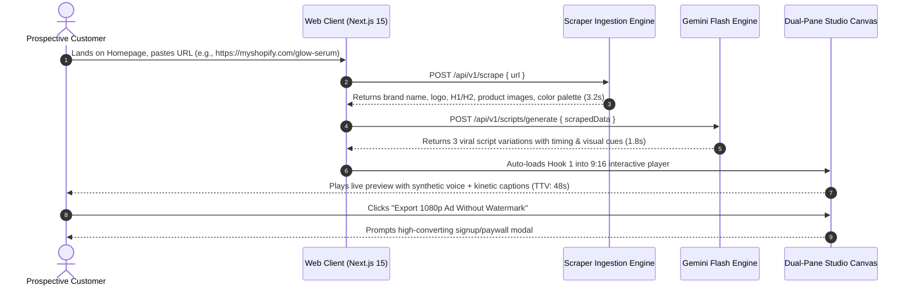
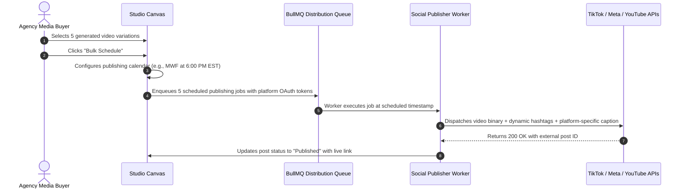

# Enterprise Product Requirements Document (PRD)
## Project: AutoUGC — Autonomous AI Video Ads & Social Distribution Engine
**Document Version:** 1.0.0  
**Target Scale:** 10,000,000+ Registered Users | 500,000+ Daily Video Renders  
**Owner:** Technical Co-Founder & Principal Systems Architect  

---

## 1. Executive Summary & Strategic Vision

### 1.1 The Market Disruption
Short-form vertical video (TikTok, Instagram Reels, YouTube Shorts) is currently the highest-converting digital advertising and organic acquisition medium in the world. However, 90% of business owners, SaaS founders, and direct-to-consumer (DTC) brands cannot participate effectively:
1. **Camera Paralysis**: Founders and operators dread appearing on camera.
2. **Exorbitant Agency Costs**: Traditional UGC agencies charge $1,500 to $4,000/month for 4 to 8 videos, with a turnaround time of 14–21 days.
3. **Creative Fatigue**: Algorithmic ad platforms exhaust ad creative fatigue within 7–10 days, requiring constant split-testing of video hooks.
4. **Distribution Friction**: Even when videos are produced, manually formatting, exporting, and posting across multiple platforms creates substantial operational drag.

### 1.2 The AutoUGC Value Proposition
AutoUGC reduces the time-to-first-ad from **14 days to under 60 seconds**.
A user inputs their product URL $\to$ AutoUGC scrapes value propositions, images, and brand assets $\to$ Gemini Flash AI generates 3 psychographically tested viral hooks $\to$ The Remotion engine stitches ultra-realistic voiceover, kinetic word-by-word captions, dynamic product mockups, and B-roll into high-converting 10–20 second 9:16 vertical videos $\to$ The user publishes or schedules directly to TikTok, Instagram, and YouTube in 1 click.

### 1.3 Key Financial & Performance Targets
- **Target Sub-60s Time-to-Value (TTV)**: A visitor must produce a fully previewable video creative within 60 seconds of landing on the site.
- **Gross Margin Target**: $\ge 88\%$ software gross margin across all tiers.
- **Cost Per Generated Video (COGS)**: $\le \$0.035$ per 15-second render.
- **P95 Latency**: Scraping $\le 3.5\text{s}$, Script Generation $\le 2.0\text{s}$, Video Render $\le 15.0\text{s}$.

---

## 2. User Personas & Detailed User Journeys

### 2.1 Persona Matrix

| Attribute | Persona A: The Solo SaaS Builder | Persona B: The DTC E-Commerce Operator | Persona C: The Performance Agency Media Buyer |
| :--- | :--- | :--- | :--- |
| **Typical Role** | Founder, Indie Hacker, CTO | Shopify Store Owner, Brand Director | Media Buyer, Paid Social Lead |
| **Primary Goal** | Launch marketing campaigns without being on camera | Scale Facebook/TikTok ROAS with 20+ hook variations weekly | Rapidly test creative angles for 10+ clients with minimal overhead |
| **Current Pain Point** | Zero video editing skills; no marketing team | Expensive creator sourcing; 2-week delays killing product trends | High freelancer turnover; inconsistent video quality |
| **Key Metric** | Organic signups & initial MRR growth | Blended CAC (Customer Acquisition Cost) & ROAS | Creative output velocity & Cost-Per-Creative |
| **Willingness to Pay** | $49 – $89 / month | $89 – $199 / month | $199 – $499+ / month |

---

### 2.2 End-to-End User Journeys

#### Journey 1: The Zero-Friction "First Win" (Acquisition to Activation)

#### Journey 2: The Multi-Account Agency Scheduling Workflow

---

## 3. Functional Requirements (FR-01 to FR-10)

### FR-01: Authentication, Multi-Tenancy & Access Control
- **FR-01.1**: The system MUST support passwordless magic-link authentication and OAuth 2.0 (Google, GitHub) with session-based secure HTTP-only cookies.
- **FR-01.2**: The system MUST implement multi-tenant organization isolation where each user belongs to an `Organization`. All data (projects, assets, videos, subscriptions) MUST be strictly scoped to `organization_id`.
- **FR-01.3**: The system MUST enforce Role-Based Access Control (RBAC):
  - `Owner`: Full billing, organization deletion, API keys, team management.
  - `Admin`: Project creation, video generation, social account connections.
  - `Editor`: Video script editing, previewing, and asset uploading.
  - `Viewer`: Read-only access to preview generated videos.
- **FR-01.4**: All API requests MUST validate session integrity, rate limits, and tenant boundaries at Edge Middleware prior to route handler execution.

### FR-02: URL Content Ingestion & Asset Scraping Engine
- **FR-02.1**: The system MUST accept any valid HTTP/HTTPS URL and complete content extraction in $\le 4.0$ seconds.
- **FR-02.2**: The scraper MUST extract:
  - Document Title, OpenGraph title, Twitter Card title.
  - Meta description, OpenGraph description.
  - Primary value propositions from semantic `<h1>`, `<h2>`, and high-contrast callout elements.
  - Favicon and high-resolution logo images (`<link rel="icon">`, OpenGraph image, structured data logo).
  - Up to 10 product/feature images with natural dimensions $\ge 400\times 400$px.
  - Primary brand color palette extracted via image color quantization or CSS stylesheet analysis.
- **FR-02.3**: The scraper MUST implement bot-mitigation bypass:
  - Rotating residential proxy fallbacks when encountering HTTP 403 or 429.
  - Clean HTML sanitization stripping all `<script>`, `<style>`, SVG path definitions, and inline base64 noise to minimize token payload to Gemini.
- **FR-02.4**: If a target URL is unreachable, dead, or password-protected, the scraper MUST fail gracefully in $\le 2.0$ seconds with an actionable fallback UI permitting manual product description entry.

### FR-03: AI Viral Script & Creative Hook Generation Engine
- **FR-03.1**: The system MUST integrate with Google Gemini 2.5 Flash via structured JSON schema output to eliminate schema parsing hallucinations.
- **FR-03.2**: The generator MUST produce three distinct psychographic creative angles per URL:
  - **Angle A (The Pattern Interrupt / Negative Hook)**: "Stop doing [Manual Problem] in 2026. If you're still [Frustrating Action], you need to see this..."
  - **Angle B (The Secret Hack / Curiosity Hook)**: "I found an insane hack that automatically [Key Benefit] in 2 clicks..."
  - **Angle C (The Problem $\to$ Agitation $\to$ Relief Hook)**: "Why does nobody talk about how painful [Pain Point] is? Here is the exact fix..."
- **FR-03.3**: Each generated script structure MUST contain:
  - `hook`: High-retention opening line (0.0s – 3.0s).
  - `body`: Proof, problem agitation, and product demonstration (3.0s – 11.0s).
  - `cta`: Direct, urgent call to action (11.0s – 15.0s).
  - `visual_cues`: Array of suggested imagery/screens for each section.
  - `caption_text`: Formatted social caption with 5 high-converting niche hashtags.
- **FR-03.4**: Script length MUST be strictly bounded between 35 and 55 words to guarantee natural cadence within a 12–16 second runtime.

### FR-04: Multi-Track Vertical Video Synthesis Engine
- **FR-04.1**: The engine MUST synthesize vertical 9:16 aspect ratio video (native $1080\times 1920$ resolution) at 30 frames per second using Remotion and serverless rendering workers.
- **FR-04.2**: The video layout MUST support modular multi-track composition:
  - **Track 1 (Background Visual)**: Dynamic high-energy B-roll, product screenshot zoom/pan, or split-screen device mockup.
  - **Track 2 (Dynamic Overlays)**: High-resolution brand logo, star rating badge, discount banner, or interactive cursor animations.
  - **Track 3 (Kinetic Subtitles)**: Centered or lower-third word-by-word highlighted captions synchronized to exact audio phoneme/word timestamps ($\le 50$ms drift).
  - **Track 4 (Voiceover Track)**: Synthesized speech normalized to $-14$ LUFS broadcast standard.
  - **Track 5 (Background Music Track)**: Royalty-free upbeat lo-fi or phonk background audio ducked automatically to $-22$ dB when voiceover is active.
- **FR-04.3**: The rendering pipeline MUST produce an MP4 output with H.264 video codec and AAC audio codec compatible with TikTok, Instagram Reels, and YouTube Shorts.
- **FR-04.4**: For free-tier users, the engine MUST apply a subtle, semi-transparent watermark in the bottom corner without obscuring subtitle readability.

### FR-05: Conversational Voiceover & Audio Engine
- **FR-05.1**: The system MUST generate ultra-natural creator voiceover utilizing OpenAI TTS (`tts-1-hd`) or Deepgram Aura with latency $\le 1.5$ seconds for a 50-word script.
- **FR-05.2**: The system MUST provide at least 6 distinct creator personas:
  - `Alex` (Casual, authentic 24-year-old male DTC creator).
  - `Emma` (High-energy, enthusiastic 22-year-old female creator).
  - `Marcus` (Authoritative, confident B2B SaaS founder).
  - `Sophia` (Relatable, articulate tech reviewer).
  - `Liam` (Chill, fast-paced storyteller).
  - `Chloe` (Warm, conversational lifestyle narrator).
- **FR-05.3**: The audio engine MUST return exact word-level timestamp offsets `[{ word: string, start: number, end: number }]` to drive kinetic subtitle animations in Remotion.
- **FR-05.4**: Audio files MUST be cached directly in Cloudflare R2 using the SHA-256 hash of the script text + voice ID to prevent duplicate generation costs.

### FR-06: Dual-Pane Creator Studio & Interactive Canvas
- **FR-06.1**: The user interface MUST feature an interactive dual-pane studio:
  - **Left Pane (The Phone Canvas)**: 9:16 mobile viewport with interactive HTML5/WebGL player, play/pause controls, timeline scrubber, and mute toggle.
  - **Right Pane (Precision Controls)**: Accordion-organized controls for Hook text, Voice selection, Subtitle styling (colors, font size, stroke), Background music selector, and Brand color overrides.
- **FR-06.2**: Changes made to text, colors, or voice MUST update the canvas preview in real time ($\le 100$ms) using client-side React rendering before final serverless MP4 export.
- **FR-06.3**: The studio MUST provide a "Regenerate Angle" button that triggers single-hook re-generation without wiping out custom project settings.

### FR-07: Social Media Publishing & Multi-Platform Scheduler
- **FR-07.1**: The system MUST support OAuth 2.0 integration with:
  - TikTok Content Posting API.
  - Meta Graph API (Instagram Reels for Business/Creator accounts).
  - YouTube Data API v3 (YouTube Shorts upload).
- **FR-07.2**: The scheduler MUST support:
  - Immediate 1-click dispatch.
  - Custom date and time scheduling with timezone localization.
  - Recurring cadence (e.g., "Post 1 ad variation every Tuesday & Thursday at 7:00 PM").
- **FR-07.3**: The system MUST provide an external Webhook & Zapier/Make.com integration dispatching `video.completed` and `video.scheduled` payloads with direct downloadable S3/R2 presigned URLs for users who prefer custom marketing automation tools.
- **FR-07.4**: Failed posts MUST automatically trigger exponential backoff retries (up to 3 attempts over 2 hours) and issue real-time email/in-app alert notifications.

### FR-08: Subscription Management, Metered Billing & Quotas
- **FR-08.1**: The system MUST integrate Stripe Billing via customer portals and webhooks.
- **FR-08.2**: Three standard subscription tiers MUST be supported:
  - **Starter ($49/month)**: 25 video renders/month, 1 team seat, standard queue, watermark removed.
  - **Growth ($89/month)**: 75 video renders/month, 3 team seats, priority queue, bulk scheduling.
  - **Scale / Agency ($199/month)**: 250 video renders/month, 10 team seats, ultra-priority queue, multi-account social publishing, API access.
- **FR-08.3**: Credit deduction MUST be strictly transactional and atomic:
  - 1 Credit is deducted only upon successful final MP4 render generation.
  - Previewing scripts, voice samples, and client-side canvas scrubbing MUST NOT consume credits.
  - If a render fails in the worker queue, the credit MUST be automatically refunded within the database transaction.
- **FR-08.4**: Users MUST have the ability to purchase on-demand add-on credit bundles ($20 for 15 additional credits) without altering their base monthly plan.

### FR-09: Programmatic SEO (pSEO) & Public Template Engine
- **FR-09.1**: The system MUST support programmatic SSR/SSG landing pages for high-intent queries:
  - `/templates/[niche-slug]` (e.g., `/templates/tiktok-ugc-skincare-ads`, `/templates/saas-explainer-reels`).
  - `/tools/[utility-slug]` (e.g., `/tools/viral-ugc-hook-generator`, `/tools/tiktok-ad-script-calculator`).
- **FR-09.2**: Each programmatic page MUST dynamically render:
  - Unique meta titles, descriptions, and OpenGraph images generated at edge.
  - Rich JSON-LD schema (`SoftwareApplication`, `FAQPage`, `VideoObject`).
  - An interactive embedded demo widget allowing visitors to test 1 hook without signing up.
- **FR-09.3**: Sitemaps MUST be split hierarchically and auto-updated upon database additions of new templates or public case studies.

### FR-10: Analytics, Telemetry & Performance Dashboard
- **FR-10.1**: The platform MUST provide a real-time dashboard displaying:
  - Total videos generated and remaining monthly credits.
  - Scheduled post calendar with status indicators (Pending, Published, Failed).
  - Social performance metrics (Views, Likes, Shares) ingested via social APIs where available.
- **FR-10.2**: The application MUST emit standardized telemetry events to PostHog:
  - `funnel_url_submitted`
  - `funnel_script_generated`
  - `funnel_canvas_previewed`
  - `funnel_export_initiated`
  - `checkout_completed`

---

## 4. Non-Functional Requirements (NFR-01 to NFR-10)

### NFR-01: Latency & Response Time Budgets
- All public marketing and landing pages MUST achieve a Largest Contentful Paint (LCP) $\le 1.2$ seconds globally.
- Cumulative Layout Shift (CLS) MUST be $\le 0.02$.
- Interaction to Next Paint (INP) MUST be $\le 80$ milliseconds.
- Core REST API endpoints (`/api/v1/*`) MUST respond with P95 latency $\le 120$ milliseconds under standard load (excluding third-party AI generation streams).

### NFR-02: Scalability & Throughput Capacity
- The architecture MUST horizontally autoscale to support:
  - 10,000,000 registered users.
  - 50,000 concurrent active web sessions.
  - 500,000 daily video render jobs distributed across background worker pools.
- The database connection pooler (PgBouncer) MUST support up to 5,000 inbound serverless application connections without connection starvation or latency degradation.

### NFR-03: Availability, Durability & Resilience
- The system MUST achieve $99.95\%$ monthly service availability (excluding planned maintenance).
- Media storage on Cloudflare R2 MUST maintain eleven nines ($99.999999999\%$) annual durability.
- All background jobs MUST implement exponential backoff with jitter and a maximum of 3 retries before dead-lettering.
- In the event of a total primary database failure, read replicas MUST promote to primary within $\le 30$ seconds.

### NFR-04: Security & Cryptographic Standards
- All data in transit MUST be encrypted via TLS 1.3.
- All sensitive customer credentials (social OAuth tokens, API secrets) MUST be encrypted at rest using AES-256-GCM with envelope key encryption.
- User passwords (if used) MUST be hashed with Argon2id (memory: 64MB, iterations: 3, parallelism: 4).
- Application endpoints MUST enforce strict Content Security Policy (CSP), HTTP Strict Transport Security (HSTS), and Cross-Origin Resource Sharing (CORS) headers.
- Rate limiting MUST be enforced at the Edge:
  - Public unauthenticated endpoints: 15 requests / minute per IP.
  - Authenticated user endpoints: 120 requests / minute per API token.

### NFR-05: Maintainability, Modular Decoupling & Testability
- The codebase MUST maintain $\ge 85\%$ unit test coverage on core business logic (script generation, credit ledger, billing webhooks).
- All APIs MUST be defined with strict Zod schemas and end-to-end TypeScript interfaces.
- The video rendering worker MUST be decoupled from the primary web application repository, enabling independent blue/green deployments and isolated scaling.

---

## 5. Edge Cases, Failure Modes & Graceful Degradation Catalog

| ID | Failure Scenario | Trigger Condition | System Behavior & Mitigation Protocol | User-Facing Experience |
| :--- | :--- | :--- | :--- | :--- |
| **EC-01** | Target URL blocks scraping | Cloudflare bot protection, 403 Forbidden, 429 Too Many Requests | 1. Attempt fallback via secondary residential proxy. 2. If secondary fails within 2.5s, abort scrape pipeline. 3. Open manual entry drawer. | "We couldn't reach that URL directly. Paste your 1-line product pitch below to proceed in 5 seconds!" |
| **EC-02** | Target site is completely media-free | Text-only blog, minimal documentation page | Ingestion engine falls back to curated high-retention industry B-roll library and dynamic code/text canvas animations. | Clean, dynamic typography video with upbeat motion graphics; zero broken image icons. |
| **EC-03** | TTS Voiceover API timeout | ElevenLabs / OpenAI TTS exceeds 4.0s response threshold | Circuit breaker trips; automatically re-routes request to Deepgram Aura backup TTS cluster within 800ms. | Seamless render; zero error modal shown to customer. |
| **EC-04** | Remotion Lambda OOM / Crash | Complex asset resolution exceeds 2048MB memory | Worker catches SIGSEGV/OOM; retries job on 3008MB high-memory queue slice; alerts monitoring. | Progress bar pauses for 4 seconds, then completes smoothly. |
| **EC-05** | User closes browser during render | Client disconnects WebSocket/SSE connection | Background worker continues job to completion; stores final MP4 in R2; updates database; sends email notification with download link. | User receives email: "Your viral UGC ad is ready! Click here to download or schedule." |
| **EC-06** | Social OAuth token revoked by user | User revokes permission inside TikTok/Instagram settings | Scheduled publisher receives 401 Unauthorized; marks post as `auth_required`; halts retries to prevent account spam bans. | In-app notification & email: "Please reconnect your TikTok account to publish your scheduled video." |
| **EC-07** | Stripe webhook duplicate delivery | Network replay or Stripe retry storm | Webhook handler checks Redis key `stripe:event:{id}` with atomic `SETNX`. Duplicate events return immediate `200 OK`. | Zero duplicate credit charges; zero double invoices. |
