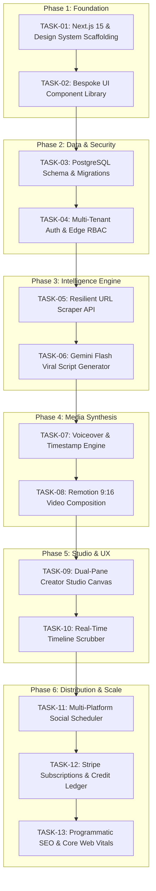

# Master Implementation Tasks & Execution Roadmap
## Project: AutoUGC — Autonomous AI Video Ads & Social Distribution Engine
**Document Version:** 1.0.0  
**Target Scale:** 10,000,000+ Registered Users | 500,000+ Daily Video Renders  
**Owner:** Technical Co-Founder & Principal Systems Architect  

---

## 1. Execution Protocol & Engineering Standards

### 1.1 Git Commit Convention
Every task MUST be committed individually upon passing its verification criteria.
We strictly follow the Conventional Commits specification:
```
<type>(<scope>): <short imperative summary>

[optional body explaining rationale and trade-offs]

Closes: TASK-XX-YY
```
- **Allowed Types**: `feat`, `fix`, `refactor`, `perf`, `test`, `chore`, `docs`.
- **Allowed Scopes**: `scaffold`, `design-system`, `db`, `scraper`, `llm`, `video-engine`, `audio`, `studio`, `social`, `billing`, `seo`.

### 1.2 The "Zero-Regression" Gate
Before marking any task as complete:
1. `npm run lint` must pass with zero errors and zero warnings.
2. `npm run typecheck` (or `tsc --noEmit`) must pass with zero type errors.
3. Relevant unit and integration tests must execute and pass.
4. UI components must render with zero layout shifts (CLS < 0.02) and support both dark and high-contrast modes.

---

## 2. Phase-by-Phase Task Matrix



---

## 3. Detailed Task Specifications

### PHASE 1: Workspace Scaffolding & Bespoke Design System

#### TASK-01-01: Initialize Next.js 15 Application with Strict TypeScript
- **Objective**: Scaffold the production Next.js 15 App Router project with TypeScript 5.5, Tailwind CSS, and essential dev tooling.
- **Dependencies**: None.
- **Target Files**:
  - `package.json`
  - `tsconfig.json`
  - `next.config.ts`
  - `tailwind.config.ts`
  - `postcss.config.mjs`
  - `.eslintrc.json`
  - `.prettierrc`
- **Implementation Steps**:
  1. Initialize Next.js 15 using `create-next-app` in non-interactive mode with Tailwind CSS and App Router.
  2. Configure `tsconfig.json` with strict mode (`strict: true`, `noUncheckedIndexedAccess: true`, `exactOptionalPropertyTypes: true`).
  3. Install core dependencies: `clsx`, `tailwind-merge`, `lucide-react`, `zod`, `framer-motion`.
  4. Configure Next.js security headers in `next.config.ts` (HSTS, CSP, X-Frame-Options: DENY, X-Content-Type-Options: nosniff).
- **Verification Gate**:
  - Run `npm run build` and ensure production compilation succeeds with zero warnings.
- **Commit Message**: `chore(scaffold): initialize next.js 15 app router with strict typescript and security headers`

---

#### TASK-01-02: Implement Bespoke "Anti-AI Slop" Design System Tokens
- **Objective**: Establish the core CSS variables, Tailwind color tokens, and typography system avoiding AI tropes.
- **Dependencies**: `TASK-01-01`.
- **Target Files**:
  - `src/app/globals.css`
  - `tailwind.config.ts`
  - `src/lib/utils.ts`
- **Implementation Steps**:
  1. Define CSS variables for Deep Obsidian (`#09090B`), Warm Slate (`#121215`), Electric Amber (`#F59E0B`), and Emerald (`#10B981`).
  2. Configure Google Fonts (`Plus Jakarta Sans` for display headings, `Inter` for interface, `Geist Mono` for numbers/durations).
  3. Implement `cn()` class merger utility using `clsx` and `tailwind-merge`.
  4. Create custom utility classes for tactile 1px borders (`border-subtle`), inset shadows, and active button depressions.
- **Verification Gate**:
  - Inspect test page in browser: verify fonts load without layout shifts, color tokens match design specs, and borders render cleanly at 1px resolution.
- **Commit Message**: `feat(design-system): implement bespoke color tokens, typography and tactile border utilities`

---

#### TASK-01-03: Build Tactile Core UI Components
- **Objective**: Create the primary interactive atoms: Button, Input, Card, Modal, and Badge.
- **Dependencies**: `TASK-01-02`.
- **Target Files**:
  - `src/components/ui/Button.tsx`
  - `src/components/ui/Input.tsx`
  - `src/components/ui/Card.tsx`
  - `src/components/ui/Badge.tsx`
  - `src/components/ui/Modal.tsx`
- **Implementation Steps**:
  1. Build `Button.tsx` supporting variants (`primary` amber, `secondary` slate, `outline`, `ghost`, `danger`) with spring micro-interactions (`active:scale-[0.98]`).
  2. Build `Input.tsx` with focused state glowing border, error message display, and left/right icon slots.
  3. Build `Card.tsx` with subtle glassmorphic backdrop filter and 1px border.
  4. Build accessible `Modal.tsx` using HTML `<dialog>` or Headless UI with keyboard Escape dismissal and background focus trapping.
- **Verification Gate**:
  - Unit test all button variants and click handlers. Verify modal opens/closes cleanly without body scroll leaks.
- **Commit Message**: `feat(design-system): build tactile accessible core component primitives`

---

### PHASE 2: Database Layer, Migrations & Tenancy

#### TASK-02-01: Database Schema & Migration Setup
- **Objective**: Setup Prisma ORM / Drizzle ORM and generate PostgreSQL database migrations for tenancy, projects, and credits.
- **Dependencies**: `TASK-01-01`.
- **Target Files**:
  - `prisma/schema.prisma` (or `src/db/schema.ts`)
  - `src/db/client.ts`
  - `prisma/migrations/*`
- **Implementation Steps**:
  1. Define models matching `docs/design.md`: `Organization`, `User`, `OrganizationMember`, `Subscription`, `CreditTransaction`, `Project`, `ScrapedAsset`, `Script`, `Video`, `SocialAccount`, `ScheduledPost`.
  2. Configure UUIDv7 / `gen_random_uuid()` defaults on all primary keys.
  3. Create composite indexes on high-frequency query paths (`(organization_id, render_status)`, `(user_id, email)`).
  4. Set up Prisma / Drizzle client singleton with PgBouncer connection pooling configuration.
- **Verification Gate**:
  - Run migration command (`npx prisma migrate dev` or `drizzle-kit push`); verify all 11 tables and indexes are created successfully in PostgreSQL.
- **Commit Message**: `feat(db): implement relational multi-tenant schema with credit ledger and performance indexes`

---

#### TASK-02-02: Authentication & Edge Middleware Tenant Isolation
- **Objective**: Implement secure session authentication and Edge Middleware for route protection and tenant scoping.
- **Dependencies**: `TASK-02-01`.
- **Target Files**:
  - `src/middleware.ts`
  - `src/lib/auth.ts`
  - `src/app/api/auth/[...route]/route.ts`
- **Implementation Steps**:
  1. Set up session management using Iron Session or Supabase Auth with secure HTTP-only cookies.
  2. Implement `src/middleware.ts` to intercept `/dashboard/*`, `/studio/*`, and `/api/v1/*` routes:
     - Verify JWT/session validity.
     - Extract `organization_id` from session.
     - Attach tenant context headers for downstream API route handlers.
     - Enforce rate limits via Redis token-bucket algorithm.
- **Verification Gate**:
  - Automated tests: Unauthenticated requests to protected routes receive 401 Unauthorized or redirect to `/sign-in`.
- **Commit Message**: `feat(auth): configure edge middleware session verification and tenant isolation`

---

### PHASE 3: URL Scraping & Intelligence Ingestion

#### TASK-03-01: Resilient URL Scraper API
- **Objective**: Implement `/api/v1/projects/scrape` to extract product copy, logos, images, and brand colors in $\le 3.5$s.
- **Dependencies**: `TASK-02-01`.
- **Target Files**:
  - `src/app/api/v1/projects/scrape/route.ts`
  - `src/lib/scraper/extractor.ts`
  - `src/lib/scraper/colorThief.ts`
  - `src/lib/scraper/ssrfFilter.ts`
- **Implementation Steps**:
  1. Build SSRF protection: Resolve IP via DNS and block private subnet CIDR ranges (`127.0.0.0/8`, `10.0.0.0/8`, `169.254.0.0/16`).
  2. Fetch HTML using `cheerio` with standard Chrome user-agent headers.
  3. Extract OpenGraph titles, meta descriptions, semantic headings (`h1`, `h2`), and high-res images ($\ge 400\times 400$px).
  4. Extract dominant brand colors using hex frequency analysis or image canvas quantization.
  5. Fallback gracefully if target URL blocks scraping: return structured error prompting manual entry.
- **Verification Gate**:
  - Test scraping against 5 diverse real-world URLs (Shopify store, Stripe landing page, Substack blog, Amazon product page, dead link). Verify output conforms strictly to Zod schema.
- **Commit Message**: `feat(scraper): implement resilient ssrf-protected url content and asset extractor`

---

#### TASK-03-02: Gemini 2.5 Flash Viral Hook & Script Engine
- **Objective**: Implement `/api/v1/scripts/generate` utilizing Google Gemini 2.5 Flash with structured JSON outputs.
- **Dependencies**: `TASK-03-01`.
- **Target Files**:
  - `src/app/api/v1/scripts/generate/route.ts`
  - `src/lib/ai/gemini.ts`
  - `src/lib/ai/prompts.ts`
  - `src/lib/ai/schema.ts`
- **Implementation Steps**:
  1. Initialize the official Google Gen AI SDK (`@google/genai`) using Gemini 2.5 Flash.
  2. Engineer high-retention system prompt codifying the 3 viral hook frameworks:
     - Framework 1: The Pattern Interrupt ("Stop doing X in 2026").
     - Framework 2: The Secret Hack ("The $80 upgrade nobody talks about").
     - Framework 3: The Problem $\to$ Agitation $\to$ Relief.
  3. Enforce strict JSON schema output matching `Script` interface with word count bounds (35–55 words).
  4. Generate matching viral captions and 5 targeted niche hashtags per script.
- **Verification Gate**:
  - Run 10 consecutive script generations. Verify 100% valid JSON parse rate, zero schema violations, and execution time $\le 2.0$ seconds.
- **Commit Message**: `feat(llm): integrate gemini 2.5 flash structured viral script and hook generator`

---

### PHASE 4: Media Synthesis & Remotion Video Engine

#### TASK-04-01: Voiceover Synthesis with Word-Level Timestamps
- **Objective**: Implement text-to-speech audio synthesis with exact phoneme/word timestamps for kinetic caption sync.
- **Dependencies**: `TASK-03-02`.
- **Target Files**:
  - `src/app/api/v1/audio/synthesize/route.ts`
  - `src/lib/audio/ttsProvider.ts`
  - `src/lib/audio/cache.ts`
- **Implementation Steps**:
  1. Connect OpenAI TTS / Deepgram Aura API for human-like conversational creator speech.
  2. Provide 6 distinct creator persona presets (`Alex`, `Emma`, `Marcus`, etc.).
  3. Extract word timestamps `[{ word: string, start: number, end: number }]`.
  4. Cache generated audio files in Cloudflare R2 keyed by SHA-256 hash of script text + voice ID.
- **Verification Gate**:
  - Generate audio for a 45-word script. Verify audio playback duration matches word timestamps with $\le 50$ms variance.
- **Commit Message**: `feat(audio): implement conversational tts engine with word-level kinetic timestamp alignment`

---

#### TASK-04-02: Remotion 9:16 Video Composition Engine
- **Objective**: Architect the Remotion React video composition component for 1080x1920 vertical video ads.
- **Dependencies**: `TASK-04-01`.
- **Target Files**:
  - `src/remotion/Root.tsx`
  - `src/remotion/compositions/UgcAdComposition.tsx`
  - `src/remotion/components/KineticSubtitles.tsx`
  - `src/remotion/components/DynamicBackground.tsx`
  - `src/remotion/components/BrandOverlay.tsx`
- **Implementation Steps**:
  1. Configure Remotion root composition with 1080x1920 resolution at 30 fps.
  2. Implement `KineticSubtitles.tsx`: Map audio word timestamps to video frames. Apply spring scale animation and active highlight color (`#F59E0B`) to current word.
  3. Implement `DynamicBackground.tsx`: Render Ken Burns slow zoom/pan effect on scraped product images or B-roll video.
  4. Implement `BrandOverlay.tsx`: Render brand logo, star rating badge, and watermark container.
  5. Implement background audio ducking (drop music volume to -22dB during speech).
- **Verification Gate**:
  - Render Remotion preview player in browser: verify 30fps playback smoothness and precise subtitle-voice synchronization.
- **Commit Message**: `feat(video-engine): architect remotion vertical 9:16 composition with kinetic subtitles and audio ducking`

---

### PHASE 5: Dual-Pane Creator Studio & Interactive Canvas

#### TASK-05-01: Live Browser Video Player & Studio Layout
- **Objective**: Build the responsive dual-pane studio interface featuring the interactive 9:16 mobile canvas.
- **Dependencies**: `TASK-04-02`.
- **Target Files**:
  - `src/app/(dashboard)/studio/[id]/page.tsx`
  - `src/components/studio/StudioLayout.tsx`
  - `src/components/studio/CanvasPlayer.tsx`
  - `src/components/studio/TimelineScrubber.tsx`
- **Implementation Steps**:
  1. Build dual-pane layout: Left pane displays 9:16 phone mockup; right pane displays editing controls.
  2. Embed `@remotion/player` inside `CanvasPlayer.tsx` for client-side zero-latency playback and instant scrubbing.
  3. Build `TimelineScrubber.tsx`: Custom time scrubber with play/pause, current frame counter, and audio waveform indicator.
  4. Ensure 100% responsiveness on desktop and tablet viewports.
- **Verification Gate**:
  - Test scrubbing, looping, and muting across Chrome, Safari, and Firefox. Ensure no audio desynchronization.
- **Commit Message**: `feat(studio): build dual-pane creator studio with zero-latency remotion player canvas`

---

#### TASK-05-02: Real-Time Script & Style Editor Controls
- **Objective**: Implement right-pane editing controls allowing live visual tweaks without re-rendering server files.
- **Dependencies**: `TASK-05-01`.
- **Target Files**:
  - `src/components/studio/ScriptEditor.tsx`
  - `src/components/studio/VoiceSelector.tsx`
  - `src/components/studio/SubtitleStyler.tsx`
  - `src/components/studio/MusicPicker.tsx`
- **Implementation Steps**:
  1. Build `ScriptEditor.tsx`: Inline textarea for hook, body, and CTA copy with real-time word count and duration estimator.
  2. Build `VoiceSelector.tsx`: Dropdown with one-click voice preview samples.
  3. Build `SubtitleStyler.tsx`: Color picker for subtitle text, highlight color, and font size selector.
  4. Connect editor state directly to Remotion player props for instantaneous visual update ($\le 50$ms).
- **Verification Gate**:
  - Modify a script word in the editor; verify the subtitle text in the canvas updates instantaneously without frame flicker.
- **Commit Message**: `feat(studio): implement real-time script, voice and subtitle styling controls`

---

### PHASE 6: Social Media Publishing & Multi-Platform Scheduler

#### TASK-06-01: Social Account OAuth 2.0 Integration
- **Objective**: Connect TikTok, Instagram Reels, and YouTube Shorts via secure OAuth 2.0 flows.
- **Dependencies**: `TASK-02-02`.
- **Target Files**:
  - `src/app/api/v1/social/connect/[platform]/route.ts`
  - `src/app/api/v1/social/callback/[platform]/route.ts`
  - `src/lib/social/crypto.ts`
- **Implementation Steps**:
  1. Implement OAuth initiation endpoints with CSRF state token verification in Redis.
  2. Handle OAuth callbacks: Exchange authorization codes for long-lived access tokens.
  3. Encrypt access and refresh tokens using AES-256-GCM before persisting to `social_accounts` table.
  4. Implement automated token refresh worker to renew tokens prior to expiration.
- **Verification Gate**:
  - Simulate OAuth flow; verify tokens are stored in database as ciphertext and decrypt correctly.
- **Commit Message**: `feat(social): implement aes-256 encrypted oauth 2.0 connectors for tiktok, instagram and youtube`

---

#### TASK-06-02: Publishing Calendar & Automated Scheduler Queue
- **Objective**: Build the post scheduling modal, visual calendar, and BullMQ publishing worker.
- **Dependencies**: `TASK-06-01`.
- **Target Files**:
  - `src/app/api/v1/social/schedule/route.ts`
  - `src/components/studio/ScheduleModal.tsx`
  - `src/components/dashboard/PublishingCalendar.tsx`
  - `src/workers/socialPublisher.ts`
- **Implementation Steps**:
  1. Build `ScheduleModal.tsx`: Date/time picker, platform multi-select, and dynamic caption editor.
  2. Persist scheduled posts with `pending` status.
  3. Implement `socialPublisher.ts` worker: Polls every 60 seconds, fetches pending jobs where `scheduled_for <= NOW()`, and dispatches video binary via platform APIs.
  4. Implement automatic 3x retries with exponential backoff on platform network failures.
- **Verification Gate**:
  - Schedule a post for $T + 2\text{ minutes}$. Verify the background worker triggers, marks post as published, and records post ID.
- **Commit Message**: `feat(social): build scheduling calendar and automated multi-platform publishing queue`

---

### PHASE 7: Stripe Billing, Programmatic SEO & Scale Hardening

#### TASK-07-01: Stripe Subscriptions & Atomic Credit Ledger
- **Objective**: Implement Stripe Checkout, Customer Portal, and idempotent webhook handlers for credit quotas.
- **Dependencies**: `TASK-02-01`.
- **Target Files**:
  - `src/app/api/v1/billing/checkout/route.ts`
  - `src/app/api/v1/billing/portal/route.ts`
  - `src/app/api/v1/webhooks/stripe/route.ts`
  - `src/lib/billing/credits.ts`
- **Implementation Steps**:
  1. Configure Stripe Checkout sessions for Starter ($49), Growth ($89), and Scale ($199) plans.
  2. Implement webhook handler for `customer.subscription.created`, `updated`, and `deleted`:
     - Verify Stripe signature using `stripe.webhooks.constructEvent`.
     - Deduplicate events via Redis `SETNX stripe:event:{id}` with 24h TTL.
     - Atomically grant monthly credits in `subscriptions` and log entry in `credit_transactions`.
  3. Build atomic `deductCredit(orgId, videoId)` function wrapped in a database transaction with credit balance checks.
- **Verification Gate**:
  - Run Stripe CLI webhook simulation (`stripe trigger customer.subscription.created`). Verify database records active subscription and correct credit balance.
- **Commit Message**: `feat(billing): integrate stripe checkout, idempotent webhooks and atomic credit quota ledger`

---

#### TASK-07-02: Programmatic SEO (pSEO) & Public Templates Engine
- **Objective**: Implement SSR/SSG programmatic landing pages targeting high-intent UGC search queries.
- **Dependencies**: `TASK-01-02`.
- **Target Files**:
  - `src/app/templates/[slug]/page.tsx`
  - `src/app/tools/[slug]/page.tsx`
  - `src/app/sitemap.xml/route.ts`
  - `src/lib/seo/schema.ts`
- **Implementation Steps**:
  1. Create dynamic route `/templates/[slug]` rendering niche-specific UGC ad examples (e.g., skincare, B2B SaaS, fitness).
  2. Inject JSON-LD structured data (`SoftwareApplication`, `FAQPage`, `VideoObject`).
  3. Embed interactive 1-click preview widget allowing visitors to test the hook generator without signup.
  4. Generate dynamic sitemaps with `lastmod` headers and image sitemap extensions.
- **Verification Gate**:
  - Run Google Rich Results Test on `/templates/tiktok-ugc-skincare-ads`. Verify zero schema errors and valid rich snippet validation.
- **Commit Message**: `feat(seo): deploy programmatic landing pages with json-ld schema and dynamic sitemaps`

---

#### TASK-07-03: Performance Optimization & Core Web Vitals Hardening
- **Objective**: Ensure the entire application satisfies sub-second LCP, zero CLS, and sub-100ms API response targets.
- **Dependencies**: All preceding tasks.
- **Target Files**:
  - `src/app/layout.tsx`
  - `next.config.ts`
  - `src/lib/analytics.ts`
- **Implementation Steps**:
  1. Preload critical fonts and hero poster images using `<link rel="preload">`.
  2. Implement dynamic code splitting on heavy client libraries (`@remotion/player`, `framer-motion`).
  3. Add Cloudflare edge caching headers for all static assets (`Cache-Control: public, max-age=31536000, immutable`).
  4. Integrate PostHog telemetry tracking on core conversion funnels (URL entered $\to$ Hook picked $\to$ Export clicked $\to$ Paid conversion).
- **Verification Gate**:
  - Run Lighthouse CI audit: Performance $\ge 95$, Accessibility $\ge 98$, Best Practices $\ge 98$, SEO $\ge 100$.
- **Commit Message**: `perf(core): optimize core web vitals, code splitting and posthog telemetry funnels`
